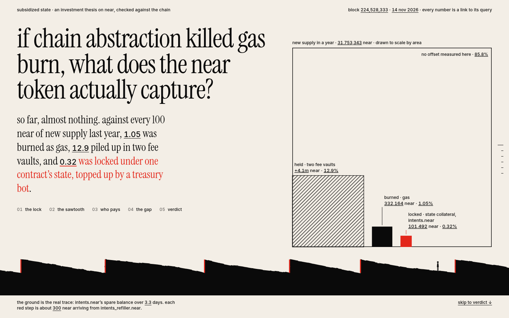
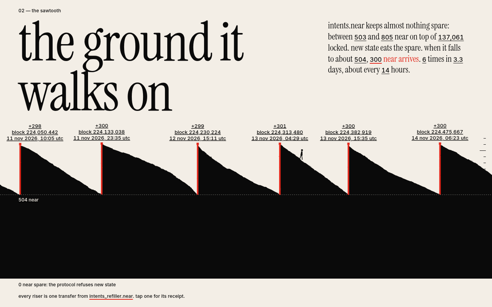
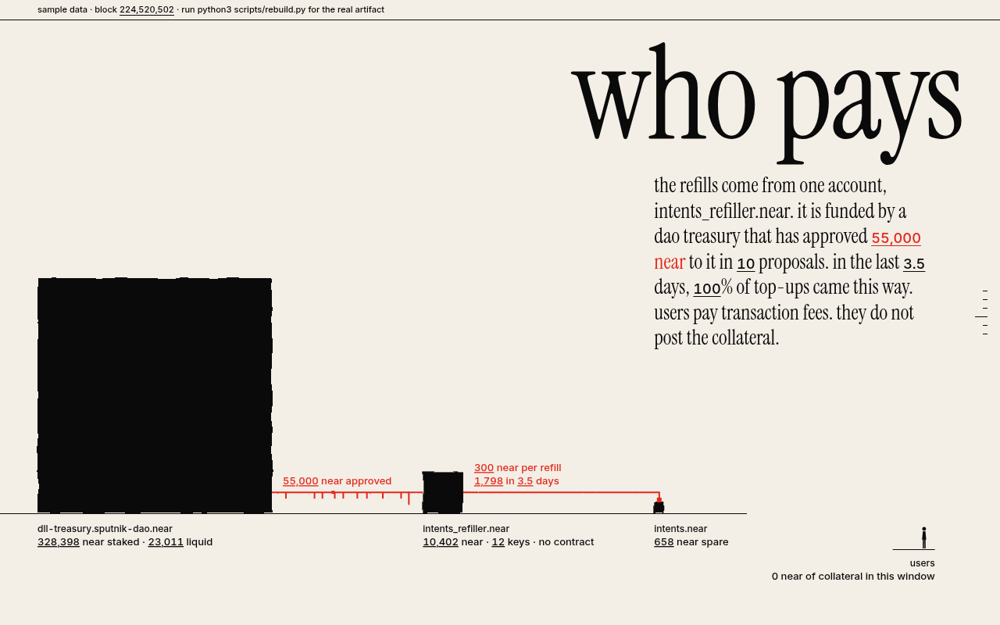
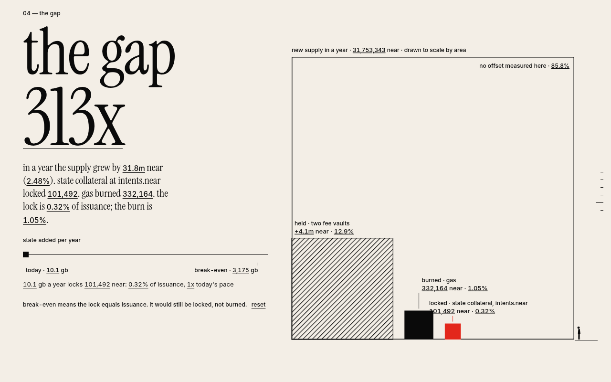
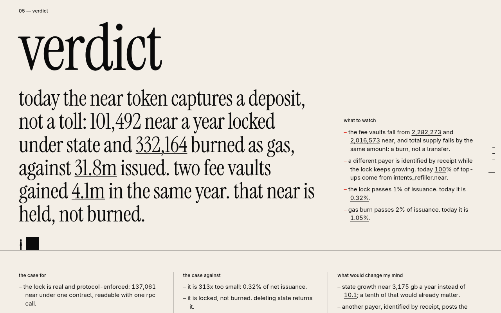

# subsidized state

**If chain abstraction killed gas burn, what does the NEAR token actually capture?**

An investment thesis on NEAR, built at NEAR Hackathon (thesis track). Every number in it is read from NEAR
mainnet by one command, with no API keys, and every number on the site links to the query behind it.

**[Live site](https://emmagh1.github.io/subsidized-state/)** · **[Demo video](https://github.com/emmaGH1/subsidized-state/releases/download/v1.0/subsidized-state-demo.mp4)** · **[The thesis](THESIS.md)** · **[The data](data/artifact.json)** · **[Every field explained](data/SCHEMA.md)**

[](https://emmagh1.github.io/subsidized-state/)

## The answer in 30 seconds

For every 100 NEAR of new supply last year, **1.05 was burned** as gas, **12.9 was held** in two fee vaults, and
**0.32 was locked** as state collateral under `intents.near`, the contract behind NEAR Intents. None of the 12.9 or
the 0.32 has left the supply. So today the token captures a deposit, not a toll.

| | Finding | The number | Where it comes from |
|---|---|---|---|
| 1 | **The lock is real and growing.** NEAR locks 10 NEAR for every megabyte a contract stores. | 137,061 NEAR locked under 13.7 GB of `intents.near` state, higher at each of 13 checkpoints across a year | `lock.checkpoints` |
| 2 | **It is far too small to offset issuance.** | +101,492 NEAR a year against 31.75 million issued: 0.32%, so issuance is **313x** the lock | `gap.multiple` |
| 3 | **It is locked, not burned.** Deleting the state returns the NEAR. | The only true burn, gas, is 332,164 NEAR a year: 1.05% of issuance | `gas_burn` |
| 4 | **The bigger flow is fees, and it is held.** | Two fee vaults gained 4.08 million NEAR in the year, 40x the lock, and still hold it at the snapshot block | `vaults` |
| 5 | **A treasury pays for the lock, not users.** | **39 of 39** top-ups of `intents.near` in 30 days came from `intents_refiller.near`, to which a DAO treasury has approved 55,000 NEAR in 10 proposals | `data/refills_30d.json`, `payer` |

What would change the verdict is listed on the site and in [THESIS.md](THESIS.md#4-what-would-change-my-mind): the fee
vaults burning what they hold, a different payer identified by receipt, the lock passing 1% of issuance, or gas burn
passing 2%.

## What it looks like

| The refill trace: each red step is 300 NEAR from the same account | Who pays: treasury, refiller, contract |
|---|---|
| [](https://emmagh1.github.io/subsidized-state/#sawtooth) | [](https://emmagh1.github.io/subsidized-state/#payer) |
| **The gap: a year of issuance against what is burned, held and locked** | **The verdict, what to watch, and three tests** |
| [](https://emmagh1.github.io/subsidized-state/#gap) | [](https://emmagh1.github.io/subsidized-state/#verdict) |

## Check it in one minute

```
git clone https://github.com/emmaGH1/subsidized-state && cd subsidized-state

# 15 offline checks of every derived number -> "Ran 15 tests", "OK"
python3 -m unittest discover tests

# the 30-day refill trace, from its cache -> "39 top-ups ... from intents_refiller.near: 39"
python3 scripts/trace_refills.py

# every number again from mainnet at today's head block -> ends in PASS C1, PASS C2, PASS C3
python3 scripts/rebuild.py
```

Python 3.9 or newer, standard library only, nothing to install. The steps below say exactly what each command prints.

## What is new here

Other entries in this hackathon (Toll Road, NEAR Toll Audit, Stakeout and others) already compare intents fees
with issuance. What this adds is a year-long ledger of the NEAR locked under `intents.near`'s
state, a block-level trace of every top-up of that collateral with the receipt that paid it, and the treasury behind
the account that pays.

## Check it yourself

You need Python 3.9 or newer (tested on 3.9 and 3.13) and an internet connection. Nothing to install.

### 1. Rebuild the data

```
git clone https://github.com/emmaGH1/subsidized-state
cd subsidized-state
python3 scripts/rebuild.py
```

You see a summary and three test lines, in about 10 to 40 seconds:

```
subsidized state: rebuilt data/artifact.json
  head block            224,528,333  (2026-11-14T14:44:54Z)
  intents.near locked   137,060.87 NEAR under 13,706,086,632 bytes
  lock growth           101,491.66 NEAR per year
  net issuance          31,753,343.43 NEAR per year
  lock / issuance       0.3196%  (issuance is 312.9x the lock)
  gas burn              332,163.85 NEAR per year (1.046% of net issuance)
  refills in window     6 over 3.334 days, 100.0% from intents_refiller.near
  network calls 144, cache hits 253, 14.5s
PASS C1  gap.lock_pct_of_issuance < 1.0 (observed 0.3196)
PASS C2  sawtooth.refill_count >= 3 (observed 6), sawtooth.from_refiller_pct == 100 (observed 100.0)
PASS C3  gas_burn.pct_of_net_issuance < 2.0 (observed 1.046)
```

That output is from the committed snapshot. **Your numbers will differ slightly**, because the script reads the
chain at the current head block: the head block, the locked amount and the supply all move every second, and
the refill count changes as the trace window (about 500,000 blocks) moves forward. The three tests should still say `PASS`.
The script rewrites `data/artifact.json` and `data/history_cache.json`; `git checkout data/` restores the snapshot
that `THESIS.md` quotes.

### 2. Run the offline checks

```
python3 -m unittest discover tests
```

You see `Ran 15 tests` and `OK`. These tests recompute every derived number in `data/artifact.json` from its
inputs (locked NEAR from bytes, the gap arithmetic, the claim results), check the file against the schema, and
check that the counts in `data/refills_30d.json` match its list of refills.

### 3. Spot-check the history cache against the chain

```
python3 scripts/rebuild.py --verify 5
```

You see five `MATCH` lines and `verify: 5 checked, 0 mismatched`. Each line is a cached historical balance
refetched from an archival node. This can take up to a minute if the archival endpoint is busy.

### 4. Open the site

```
python3 -m http.server 8000
```

Then open http://localhost:8000/site/ . You see six screens: the question, the lock, the sawtooth, who pays,
the gap, and the verdict. Click any number: a strip opens at the bottom with the field name, the block it was
read at and a `curl` you can paste into a terminal. At the bottom of the verdict, `verify live against mainnet`
queries a public RPC node from your browser and prints the artifact's values next to the chain's current ones.

### 5. Check one number by hand

The headline input is one RPC call. This asks an archival node for `intents.near` at the snapshot's head block:

```
curl -s https://archival-rpc.mainnet.fastnear.com -H 'Content-Type: application/json' \
  -d '{"jsonrpc":"2.0","id":1,"method":"query","params":{"request_type":"view_account","block_id":224528333,"account_id":"intents.near"}}'
```

You see `"storage_usage": 13706086632`. Multiply by the protocol's storage price, 10^19 yoctoNEAR per byte
(10 NEAR per MB), and you get the 137,060.87 NEAR in the output above.

### 6. Rerun the 30-day refill trace

```
python3 scripts/trace_refills.py
```

This walks back 30 days from the head block in `data/artifact.json` and resolves the sender of every top-up.
With the committed snapshot (run `git checkout data/` first if you rebuilt in step 1) you see some progress
lines and then, in about a second:

```
refill trace: 39 top-ups of intents.near over 30.418 days (blocks 220030000 to 224528333)
  from intents_refiller.near: 39   other senders: 0   unresolved: 0   total 11699.75 NEAR
  network reads 0
```

It is instant because its reads are cached in `data/refills_30d_cache.json`. If you run it after a rebuild it
extends to the new head, fetches the blocks it has not seen (a minute or two) and the counts move.
`--fresh` refetches all of it: about 900 rate-limited archival reads, which took 25 minutes when we ran it.

## How the rebuild works

`scripts/rebuild.py` is one file, Python standard library only. It reads:

| What | How |
|---|---|
| `intents.near` storage and balance at 13 points across a year | `view_account` at a block height |
| The free balance every 2,500 blocks over the last 500,000 blocks, and every refill located to its exact block | `view_account` at a block height, then bisection |
| The receipt and sender of each refill | the block's executed receipts |
| Every top-up over 30 days (`scripts/trace_refills.py`, a separate file: `data/refills_30d.json`) | `view_account` every 10,000 blocks, bisection, then the block's executed receipts |
| Treasury stake, refiller balance, DAO proposals | view calls on the staking pool and the Sputnik DAO |
| Net issuance over about 365 and 30 days | `total_supply` in block headers |
| Gas burn | the fall in `total_supply` inside an epoch, where nothing is minted |
| Fee vault balances now, 30 days ago and a year ago | `view_account` |
| `omft.near` roles, `bridge-mng.near` key count, `v1.signer` threshold | view calls and `view_access_key_list` |

**The history cache, and why it exists.** Only two keyless archival endpoints answered when we built this, and
both return HTTP 429 after a burst of roughly 40 requests. A year of checkpoints plus a dense trace is several
hundred historical reads, so an uncached run takes minutes, not seconds. Historical chain state never changes,
so the script stores each historical read in `data/history_cache.json` and a normal run fetches only the head
state and whatever is newer than the cache. Three things keep this honest:

- `--verify N` refetches N random cached entries from the chain and fails on any mismatch.
- `--fresh` ignores the cache and refetches everything. Expect several minutes and some waiting on rate limits.
- Blocks younger than about 140,000 blocks come from ordinary RPC nodes, which do not rate-limit as hard.

If the archival endpoints refuse requests before the trace reaches the head, the script still finishes: it
reports the most recent fully traced window, says so in a `note:` line and in `meta.errors`, and the next run
resumes where it stopped. Optional third-party data (USD prices for the `omft.near` float) becomes `null`
with a note if the API is down. Nothing in the thesis depends on it.

Flags: `--fresh`, `--verify N`, `--budget SECONDS` (time allowed for optional history fetches, default 40),
`--epochs N` (complete epochs to measure gas burn over, default 2).

## The three tests

Three claims with fixed thresholds, in [tests/claims.json](tests/claims.json), evaluated on every rebuild.
They were defined in `data/SCHEMA.md` (commit `de791ab`) before `rebuild.py` existed, but after exploratory
queries had shown the rough sizes. Treat them as tripwires for future rebuilds, not as blind predictions.

| | Claim | Falsified if |
|---|---|---|
| C1 | State collateral locked by `intents.near` over the trailing year is under 1% of net issuance over the same window | `gap.lock_pct_of_issuance` ≥ 1.0 |
| C2 | Every refill of `intents.near` in the trace window comes from `intents_refiller.near`, and there are at least 3 | fewer than 3 refills, another sender, or an unresolved receipt |
| C3 | Protocol burn measured from intra-epoch supply decline is under 2% of net issuance | `gas_burn.pct_of_net_issuance` ≥ 2.0 |

## What this does not show

- It measures one contract, `intents.near`, against issuance for the whole network. It is not a census of all state on NEAR, and nothing here ranks contracts by state.
- The multiple is a trailing-year average. The lock has been growing faster recently: over the last three checkpoint intervals it annualises to about 120 thousand NEAR, which is about 265x rather than 313x.
- Fee vault inflows are not traced to their source. The artifact shows that the two balances grew and that the NEAR is still held there. It does not show whether other fee revenue was burned or spent along the way.
- There is no before-and-after series for gas burn, so this does not test whether chain abstraction caused the low burn.
- The dense refill trace in the artifact covers about 3.3 days and the longer one 30.4 days, not the year. The longer trace samples every 10,000 blocks, so it would miss a top-up under 100 NEAR, or one cancelled out by more than 100 NEAR of new state inside a single step. The link from the DAO's proposals to each refill is by account, not traced transfer by transfer. The first approved proposal is from July 2026; who posted collateral before then is not shown.
- "About a year" means the exact number of days in `issuance.d365.days`; every per-year figure is annualised by it.
- Gas burn is measured over the two most recent complete epochs and the current partial one, then annualised.
- Fee vault figures are net balance changes on chain, not gross inflows.

## Repository map

```
THESIS.md                 the argument: claim, evidence for, evidence against, what would change my mind
scripts/rebuild.py        the one command
scripts/trace_refills.py  the 30-day refill trace (writes data/refills_30d.json)
data/artifact.json        every number, with the block it was read at
data/SCHEMA.md            every field: meaning, unit, source query
data/history_cache.json   immutable historical reads (see above)
data/refills_30d.json     every top-up of intents.near over 30 days, with receipt and sender
data/refills_30d_cache.json  the historical reads behind it
data/artifact.sample.json first hand-assembled snapshot, used to build the site before rebuild.py existed
tests/claims.json         the three tests
tests/test_artifact.py    offline consistency checks
tests/test_refills.py     offline checks of the 30-day refill file
LICENSE                   MIT
site/                     the static site (no build step); site/DESIGN.md is its spec
PLAN.md                   how this was built, and every decision made along the way
```

## How it was made

Built in one day, 14 November 2026, during NEAR Hackathon; every line is new, in a new repository. A human directed
a team of AI agents (Claude Fable, Claude Opus, Gemini Carbon): an orchestrator that planned, wrote the schema, the
rebuild script and the design spec, a writer for the thesis, a builder for the site, and an auditor that cloned
the repo cold and checked every number. `PLAN.md` has the decisions log, including what went wrong.

**Dependencies:** none. The scripts use the Python standard library only. The site is plain HTML, CSS and
JavaScript with no build step and no libraries; its two fonts (Instrument Serif and Inter, both under the SIL Open
Font License) are self-hosted in `site/fonts/`. Data comes from public NEAR RPC endpoints (FastNEAR, Pocket
Network, Tatum, near.org) and FastNEAR's neardata; the optional USD prices for the `omft.near` float come from
`1click.chaindefuser.com`.

**Demo video:** [subsidized-state-demo.mp4](https://github.com/emmaGH1/subsidized-state/releases/download/v1.0/subsidized-state-demo.mp4)
(1 minute 55 seconds).

**License:** MIT, see [LICENSE](LICENSE).

Built at NEAR Hackathon.
